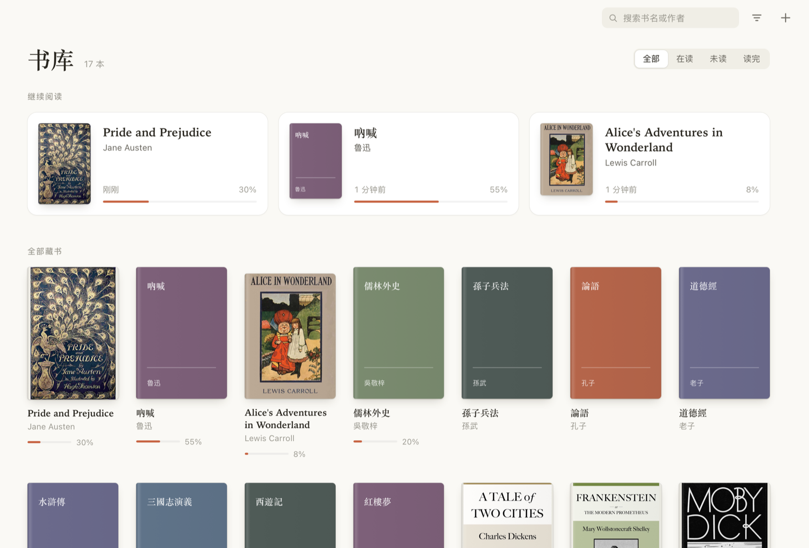
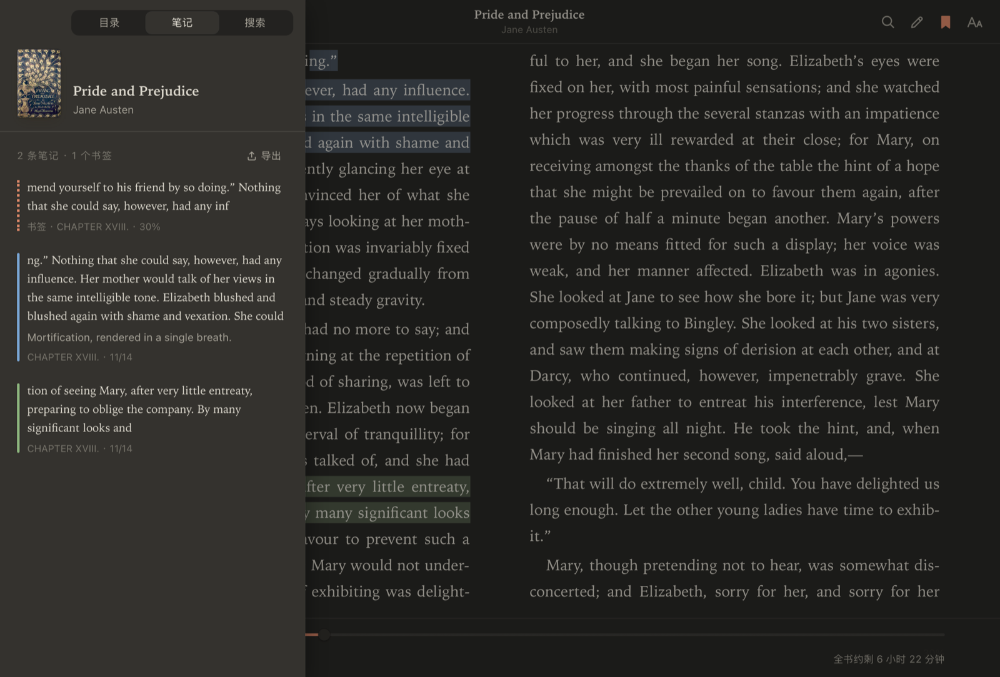
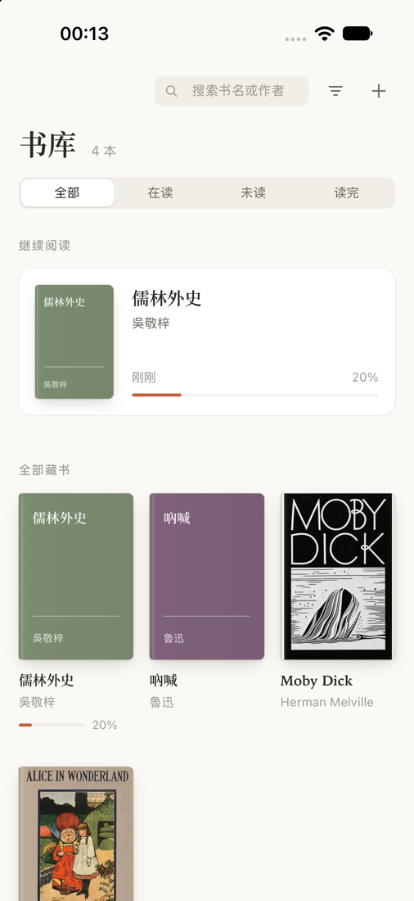
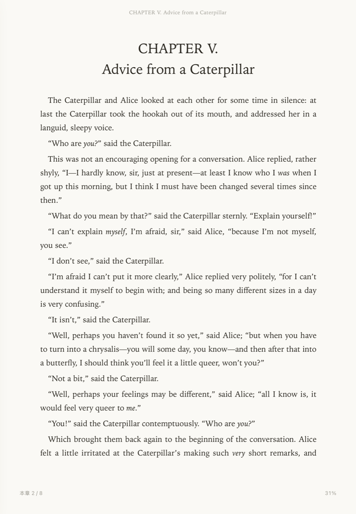

<p align="center"></p>

<h1 align="center">Inkstone · 砚</h1>

<p align="center">一个安静、好看、为中文阅读认真排过版的 EPUB 阅读器。<br>
<sub>A quiet, warm EPUB reader for macOS (and iPhone / iPad), with careful CJK typography.</sub></p>




| 笔记与深色主题 | 竖排 |
| --- | --- |
|  |  |

## 它做什么

**书库**

- 直接读出 Apple「图书」里已有的 EPUB（只读，从不改动原文件），也可以拖入或导入自己的 EPUB
- 系列书自动归成一叠（《某某 1》《某某 2》……），封面书架按最近阅读、书名、作者或添加时间排序
- 把书商塞进标题里的营销文案清理掉：`卡拉马佐夫兄弟【上海译文出品！……】（套装上下册）` 显示为 `卡拉马佐夫兄弟`
- 「继续阅读」直接回到上次的位置；在读 / 未读 / 读完筛选

**阅读**

- 左右分页（宽窗口自动双栏）或上下滚动；键盘、触控板轻扫、点击页边均可翻页
- 五套主题：纸、素、笺、黛、墨，可跟随系统明暗
- 宋 / 楷 / 仿宋 / 黑，或系统里装的任意中文字体；字号、行距、版心宽度可调
- 中文排版：标点挤压与悬挂、严格禁则、中西文间距、两端对齐，可选首行缩进
- 竖排（直排）：任何书都可以切成竖排来读
- 不看的时候工具栏和红绿灯都会退开，只留下文字

**标注**

- 五色高亮、下划线、批注；书签
- 所有笔记在侧栏汇总，可导出为 Markdown
- 全书搜索；脚注就地弹出；双击插图放大；查词典

**键盘**

| 键 | 作用 |
| --- | --- |
| `←` `→` `空格` | 翻页 |
| `T` / `N` / `⌘F` | 目录 / 笔记 / 搜索 |
| `⌘D` | 书签 |
| `⌘+` `⌘-` | 字号 |
| `⌘[` `⌘]` | 跳转后返回 / 前进 |
| `⌃⌘F` | 全屏 |
| `Esc` | 关闭面板，或回到书库 |

## 安装（macOS）

需要 macOS 13 或更新版本，以及 Swift 工具链（装了 Xcode 或 Command Line Tools 即可，**不需要**打开 Xcode）。

```bash
git clone https://github.com/ZHS-XER/Inkstone.git
cd Inkstone
scripts/build-app.sh --install     # 构建并复制到 /Applications
```

第一次读取 Apple「图书」的书库时，系统会询问是否允许 Inkstone 访问其他 App 的数据，允许即可。

## iPhone / iPad

<p>



</p>

iOS 版与 Mac 版共用同一套界面和阅读引擎，只多一层很薄的外壳（`ios/`）。需要 Xcode：

```bash
brew install xcodegen
scripts/fetch-ios-fonts.sh         # 下载宋体与楷体（约 50 MB，见下）
cd ios && xcodegen && open Inkstone.xcodeproj
```

在 Xcode 里给 `InkstoneiOS` 选好自己的开发者团队，运行到设备上即可。

- **书从哪来**：iOS 上读不到 Apple「图书」的书库（系统限制）。通过右上角的 `+`、「文件」App 里的 Inkstone 文件夹，或其他 App 的「用 Inkstone 打开」导入。
- **字体**：iOS 自带的中文字体只有苹方，没有宋体和楷体，所以 App 内置了[思源宋体（Noto Serif SC）](https://github.com/google/fonts/tree/main/ofl/notoserifsc)和[霞鹜文楷](https://github.com/lxgw/LxgwWenKai)，均为 SIL OFL 1.1 许可。字体文件较大，不放在仓库里，由上面的脚本下载；不下载也能编译，只是中文会显示为苹方。
- **同步**：Mac 与 iPhone 之间的阅读进度和笔记目前不同步。

## 结构

```
web/                   全部界面：书库、阅读器、样式（原生 ES modules，无构建步骤）
  vendor/foliate-js/   EPUB 解析、分页、CFI、搜索（MIT）
Sources/InkstoneCore/  Swift：ZIP 读取、EPUB 元数据、书库、与界面之间的桥
Sources/Inkstone/      macOS 外壳（AppKit + WKWebView）
ios/                   iPhone / iPad 外壳（SwiftUI + WKWebView），工程由 XcodeGen 生成
dev/server.mjs         开发服务器：在普通浏览器里调试界面
```

界面是一张网页，原生层通过自定义的 `inkstone://` 协议把界面和书的内容提供给它，不开任何网络端口，也不联网。Apple「图书」把书存成解包后的文件夹，其他来源是 zip；两种形式在原生层被抽象成同一个接口。

阅读进度、笔记和设置保存在 `~/Library/Application Support/Inkstone/`，每本书一个 JSON 文件。

## 开发

```bash
node dev/server.mjs          # http://127.0.0.1:4173，在浏览器里改界面
swift build && swift test    # 原生层（测试需要 Xcode 自带的 XCTest）
scripts/build-app.sh         # 打包 build/Inkstone.app
```

调试原生 App 时可以设置 `INKSTONE_WEB=$PWD/web` 让它直接读源码目录里的界面，改完按 `⌘R` 重新载入；`INKSTONE_HOME=<目录>` 让它使用一个独立的书库，不碰真实的阅读数据。

设置 `INKSTONE_DEBUG=<目录>` 后可以用 `scripts/debug-eval.sh '<js>'` 在运行中的 App 里执行脚本并取回结果和截图——Mac 和 iOS 模拟器都适用（模拟器用 `SIMCTL_CHILD_INKSTONE_DEBUG`）。

## 致谢

- [foliate-js](https://github.com/johnfactotum/foliate-js)（John Factotum，MIT）——EPUB 渲染的基础
- 设计上的暖色纸感，来自对 Claude 界面的喜爱

## 许可

[MIT](LICENSE)
